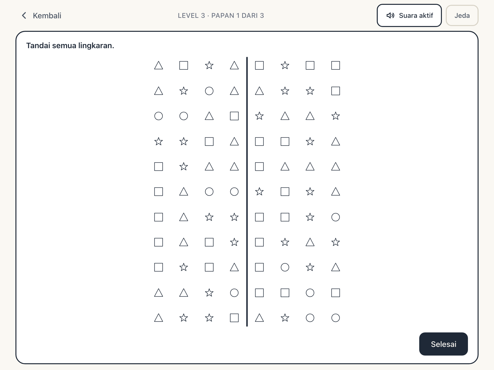

# Kognitif Visual

[](https://github.com/ryansutrisno/kognitif-visual/releases)
[](https://github.com/ryansutrisno/kognitif-visual/actions/workflows/release.yml)

Aplikasi web (PWA) untuk **melatih pemindaian visual dan atensi selektif pasien pasca stroke**, didampingi terapis. Pasien mencari dan menandai semua lingkaran di sebuah papan berisi distraktor (kotak, segitiga, bintang), lalu mendapat umpan balik suara dan layar hasil yang ramah.

Aplikasi ini **bukan alat skrining tervalidasi**. Metriknya meniru logika *cancellation test* (seperti tugas pada lembar "Skrining Kompetensi Visual") agar terapis punya data latihan yang bermakna — bukan untuk menegakkan diagnosis.

Dibuat oleh [Trazmedia](https://trazmedia.com).



---

## Daftar isi

- [Fitur](#fitur)
- [Dasar klinis](#dasar-klinis)
- [Level dan aturan papan](#level-dan-aturan-papan)
- [Cara skor dihitung](#cara-skor-dihitung)
- [Alur layar](#alur-layar)
- [Teknologi](#teknologi)
- [Struktur folder](#struktur-folder)
- [Menjalankan di lokal](#menjalankan-di-lokal)
- [Pengujian](#pengujian)
- [PWA dan mode offline](#pwa-dan-mode-offline)
- [Data, privasi, dan penghapusan](#data-privasi-dan-penghapusan)
- [Semantic release](#semantic-release)
- [Deploy](#deploy)
- [Batasan dan rencana](#batasan-dan-rencana)
- [Lisensi dan kredit](#lisensi-dan-kredit)

---

## Fitur

**Untuk pasien**

- Tiga level dengan tingkat kesulitan bertahap (area pencarian + jumlah distraktor).
- Interaksi **tap sekali** untuk menandai, tap lagi untuk membatalkan — tanpa drag, karena pasien sering tremor atau hemiparesis.
- Umpan balik langsung: kotak menjadi hijau dengan centang, atau merah dengan tanda silang.
- Umpan balik suara non-verbal ("ting" untuk benar, "tung" lembut untuk bukan target) — tanpa file audio, dibuat dengan Web Audio.
- Instruksi bersuara Bahasa Indonesia (Web Speech API) dengan tombol "Dengar lagi".
- Papan latihan 3 kotak yang **tidak dinilai** sebelum papan sesungguhnya.
- Layar hasil ramah: bintang 1–3 dan satu kalimat positif. Tidak ada angka omisi, tidak ada kata "salah".
- Istirahat 30 detik yang bisa dilewati, dan jeda otomatis saat aplikasi masuk ke latar belakang.

**Untuk terapis**

- Profil pasien lokal dengan kode (`PS-001`) + inisial, tanpa nama lengkap.
- Riwayat sesi tersimpan otomatis, termasuk sesi yang ditinggalkan di tengah jalan.
- Laporan klinis di balik PIN: tabel sesi, omisi kiri vs kanan, indeks neglect, tren antar sesi.
- Ekspor CSV siap dibuka di Excel/Google Sheets.
- Saran naik level setelah dua sesi berturut memenuhi kriteria (naik level tetap manual).
- Hapus satu pasien (beserta riwayatnya) atau hapus seluruh data dari perangkat.

**Aksesibilitas**

- Target tap minimum 44px (lantai keras 40px untuk papan 11 baris di layar sempit).
- Mode **Teks besar** (akar font 19px) dan **Kontras tinggi**.
- Toggle suara besar dan selalu terjangkau.
- Navigasi keyboard, `aria-label` pada setiap kotak papan, `focus-visible` 3px.
- Menghormati `prefers-reduced-motion`.
- Seluruh teks UI berbahasa Indonesia dan terpusat di `src/lib/i18n/id.ts`.

## Dasar klinis

Papan ini mengikuti bentuk tugas **cancellation test**: pasien mencoret semua target (di sini: lingkaran) yang tersebar di antara distraktor, dengan sebuah garis pemisah kiri–kanan di tengah papan. Pola yang lazim diamati pada pasien pasca stroke adalah **hemispatial neglect** — target di satu sisi (umumnya kiri) lebih banyak terlewat.

Karena itu aplikasi mencatat:

- **hits** — target yang berhasil ditandai,
- **false positives** — tap pada bukan target,
- **omissions** — target yang terlewat, dipisah **kiri** dan **kanan**,
- **indeks neglect** — seberapa timpang omisi antara dua sisi.

Indeks negatif berarti lebih banyak omisi di sisi kiri (pola neglect kiri yang klasik); positif berarti sebaliknya.

> Penting: angka-angka ini adalah **data latihan**, bukan hasil tes tervalidasi. Jangan dipakai untuk diagnosis atau klaim klinis tanpa studi validasi.

## Level dan aturan papan

| Level | Papan | Target (lingkaran) | Distraktor | Garis tengah | Catatan |
|-------|-------|--------------------|------------|--------------|---------|
| 1 | 3 × 3 = 9 kotak | 3 | 6 | Tidak | Pemanasan, area kecil |
| 2 | 6 × 8 = 48 kotak | 6 | 42 | Ya | Setara "kotak kecil" pada lembar cetak |
| 3 | 11 × 8 = 88 kotak | 11 | 77 | Ya | Seluruh lembar |

- Distraktor (kotak, segitiga, bintang) dibagi **seimbang** — selisih jumlah antar bentuk maksimal satu.
- Papan dibuat **deterministik** dari sebuah seed (`mulberry32`), sehingga papan yang sama bisa direproduksi persis untuk keperluan uji.
- Satu sesi default berisi maksimal **3 papan**.
- Batas sesi lembut 5 menit: setelah itu aplikasi menawarkan istirahat.

## Cara skor dihitung

Untuk satu papan (`src/features/session/scoring.ts`):

```
akurasi   = hits / targetsTotal
omissions = targetsTotal - hits
```

Indeks neglect dihitung dari total omisi kiri dan kanan:

```
neglectIndex = (omissionsRight − omissionsLeft) / (omissionsRight + omissionsLeft)
```

- Bila **tidak ada omisi sama sekali** (0/0), nilainya `null` — ditampilkan `—` dan dikosongkan di CSV. Bukan `0`, karena "tidak ada data" berbeda dari "seimbang".

Bintang pada layar hasil:

| Bintang | Syarat |
|---------|--------|
| ★★★ | akurasi ≥ 90% **dan** false positives ≤ 1 |
| ★★ | akurasi ≥ 70% |
| ★ | selain itu |

Saran naik level muncul bila **dua sesi terakhir** pada level yang sama memenuhi akurasi ≥ 90% dan omisi ≤ 1.

## Alur layar

```
Pilih profil → Pilih level → Cara bermain → Papan latihan (tidak dinilai)
      → Papan 1..3 → Layar hasil → (Istirahat) → papan berikutnya
                              ↘ Laporan terapis (PIN)
```

- Tombol **Kembali** selalu di kiri atas.
- Keluar di tengah sesi butuh konfirmasi dua langkah; sesi tetap disimpan dengan `completed = false`.
- Saat papan berjalan, header/footer aplikasi disembunyikan (mode fokus) agar Level 3 muat penuh di tablet landscape.

## Teknologi

| Bagian | Pilihan | Alasan |
|--------|---------|--------|
| UI | React 19 + TypeScript | Komponen kecil, tipe ketat untuk logika skor |
| Build | Vite 8 | Cepat, konfigurasi minim |
| Styling | Tailwind CSS v4 | Design token di CSS, tanpa runtime CSS-in-JS |
| Bentuk | SVG inline | Tajam di semua ukuran, tanpa aset gambar |
| State | Zustand | Satu store sesi, transisi lewat action |
| Penyimpanan | Dexie (IndexedDB) | Data pasien tetap di perangkat, query riwayat mudah |
| PWA | vite-plugin-pwa + Workbox | Installable, offline setelah kunjungan pertama |
| Audio | Web Audio API | Nada tanpa file audio (0 KB), langsung responsif |
| Suara | Web Speech API | Instruksi Bahasa Indonesia tanpa rekaman |
| Uji | Vitest + Testing Library via `react-dom` + Playwright | Logika murni, DOM, dan pemeriksaan visual |
| Rilis | semantic-release + GitHub Actions | Versi & changelog otomatis dari commit |

Tanpa backend. Tidak ada akun, tidak ada sinkronisasi cloud.

## Struktur folder

```
src/
├── app/App.tsx                 # shell: routing berdasarkan status sesi
├── components/                 # komponen lintas fitur
│   ├── Dialog.tsx              # dialog konfirmasi / jeda
│   ├── LogoMark.tsx
│   ├── SelectMenu.tsx          # dropdown kustom (menempel di trigger)
│   ├── SettingsSheet.tsx       # teks besar, kontras, suara, install PWA
│   ├── ShapeGlyph.tsx          # lingkaran/kotak/segitiga/bintang (SVG)
│   └── SoundToggle.tsx
├── features/
│   ├── levels/                 # tipe, config level, generator papan, PRNG
│   ├── session/                # store, scoring, layar papan/instruksi/hasil
│   ├── profiles/               # layar pilih & tambah profil pasien
│   └── report/                 # agregasi sesi, laporan, PIN, ekspor CSV
├── lib/
│   ├── audio.ts                # nada benar/salah + preferensi suara
│   ├── csv.ts                  # serialisasi & unduh CSV
│   ├── db.ts                   # skema Dexie (patients, sessions)
│   ├── i18n/id.ts              # seluruh teks UI
│   ├── install.ts              # hook beforeinstallprompt
│   ├── settings.ts             # teks besar & kontras (localStorage)
│   ├── speech.ts               # TTS Bahasa Indonesia (voice deterministik)
│   └── version.ts              # versi dari package.json
└── styles/index.css            # token warna, base, utilitas aksesibilitas
```

## Menjalankan di lokal

Prasyarat: Node.js 22+ dan npm.

```bash
npm install
npm run dev          # http://localhost:5173
npm run build        # type-check + build produksi
npm run preview      # menyajikan hasil build
```

Skrip lain:

```bash
npm test             # 85 unit test (Vitest)
npm run lint         # oxlint
npm run shots        # potret 9 layar × 4 ukuran + laporan overflow
```

`npm run shots` memerlukan `npm run preview` berjalan di port 4173. Hasilnya tersimpan di `/tmp/kognitif-shots` beserta ringkasan overflow horizontal dan tombol yang lebih kecil dari 44px.

## Pengujian

- **Unit test** (Vitest): logika skor, generator papan deterministik, agregasi sesi, CSV, penyimpanan Dexie, store sesi, layar (jsdom), pengaturan aksesibilitas, dan pemilihan voice TTS.
- **Pemeriksaan responsif** (Playwright): `npm run shots` memotret profil, level, pengaturan, instruksi, latihan, papan L1/L3, hasil, dan laporan pada 360×640, 390×844, 768×1024, dan 1024×768.
- **Cek manual tablet**: lihat checklist di [Pengujian di perangkat](#pengujian-di-perangkat).

### Pengujian di perangkat

1. `npm run build && npx vite preview --host`, buka IP yang muncul di tablet (satu jaringan).
2. Chrome → menu ⋮ → **Tambahkan ke layar utama** → buka dari ikon (tanpa address bar, landscape).
3. Mode pesawat ON → tutup dan buka lagi: aplikasi harus tetap berjalan.
4. Nyalakan **Teks besar** lalu mainkan Level 3: tidak boleh ada tombol yang keluar layar.
5. Nyalakan **Kontras tinggi**: angka pada laporan harus tetap terbaca.

## PWA dan mode offline

- `display: standalone`, `orientation: landscape`, `theme_color #FAF8F3`.
- Service worker (`generateSW`) mem-precache app shell dan seluruh aset (±400 KB).
- Tombol **Pasang di tablet** muncul di Pengaturan setelah service worker aktif (Chromium, HTTPS atau localhost). Di perangkat lain, pengaturan menampilkan petunjuk manual.
- Setelah terpasang, aplikasi bisa dibuka tanpa jaringan. Data tetap tersimpan lokal.

## Data, privasi, dan penghapusan

- **Semua data hanya di perangkat** (IndexedDB). Tidak ada backend, tidak ada telemetri, tidak ada request keluar kecuali saat memuat aplikasi pertama kali.
- Identitas pasien sengaja minimal: kode (`PS-001`), inisial, dan tahun lahir opsional. **Jangan simpan nama lengkap atau nomor rekam medis.**
- Laporan klinis dibuka dengan **PIN 4 angka**. Nilai default ada di `src/lib/db.ts` (`REPORT_PIN = '1234'`) — **ganti sebelum dipakai di klinik**.
- Ekspor CSV memakai kolom:

```csv
patient_code,session_id,level,started_at,duration_ms,targets_total,hits,false_positives,omissions_total,omissions_left,omissions_right,neglect_index,completed
```

- Hapus data: **Laporan terapis → Kelola data** → *Hapus pasien ini* (profil + seluruh riwayatnya) atau *Hapus semua data*. Keduanya lewat konfirmasi dan bersifat permanen.
- Catatan: menghapus data situs di browser juga menghapus seluruh riwayat. Ekspor CSV dulu bila perlu arsip.

## Semantic release

Versi mengikuti [Semantic Versioning](https://semver.org/lang/id/) dan dihitung otomatis dari pesan commit [Conventional Commits](https://www.conventionalcommits.org/):

| Commit | Efek versi | Contoh |
|--------|-----------|--------|
| `fix:` | patch | `1.0.0 → 1.0.1` |
| `feat:` | minor | `1.0.0 → 1.1.0` |
| `feat!:` / `BREAKING CHANGE:` | major | `1.1.0 → 2.0.0` |
| `docs:`, `refactor:`, `perf:` | patch | sesuai konfigurasi |
| `chore:`, `test:`, `style:`, `ci:` | tidak merilis | — |

Alur rilis:

1. Push/merge ke `main`.
2. GitHub Actions menjalankan `npm test` dan `npm run build`.
3. `semantic-release` menentukan versi berikutnya, membuat `CHANGELOG.md`, menaikkan `package.json`, membuat tag + GitHub Release, lalu commit `chore(release): x.y.z [skip ci]`.
4. Deploy berikutnya (Vercel/Netlify) membangun ulang dengan `package.json` baru.
5. Vite menyuntikkan versi itu ke aplikasi lewat `define: { __APP_VERSION__ }`, sehingga **footer menampilkan versi rilis terbaru** (`Kognitif · v1.0.0 · © 2026 Trazmedia`).

Rilis pertama akan menjadi **1.0.0** karena riwayat commit berisi `feat:`. Untuk memaksa rilis pertama:

```bash
GITHUB_TOKEN=... npx semantic-release --no-ci
```

atau jalankan workflow **Release** secara manual dari tab Actions (`workflow_dispatch`).

> Prasyarat: `repository.url` di `package.json` harus menunjuk ke repo GitHub yang sebenarnya, dan Actions butuh izin tulis (sudah diatur di `permissions` workflow).
>
> Repo saat ini berada di `github.com/ryansutrisno/kognitif-visual`. Ketika nanti dipindahkan ke organisasi Trazmedia, cukup perbarui `repository.url` di `package.json` dan dua URL badge di README — perilisan tetap berjalan tanpa perubahan konfigurasi lain.

Push pertama lewat SSH:

```bash
git remote add origin git@github.com:ryansutrisno/kognitif-visual.git
git push -u origin main
```

### Jika rilis pertama tidak berjalan

| Gejala | Penyebab & solusi |
|--------|-------------------|
| Workflow tidak muncul di tab Actions | Actions dinonaktifkan untuk repo, atau push bukan ke `main` |
| `Resource not accessible by integration` | Settings → Actions → General → Workflow permissions → **Read and write permissions** |
| `fatal: could not read Username` / `ENOGHPR` | `repository.url` di `package.json` tidak cocok dengan nama repo di GitHub |
| `There are no relevant changes` | Tidak ada commit `feat:` / `fix:` yang belum pernah dirilis |
| Rilis berikutnya jadi `1.0.1`, bukan `1.0.0` | Normal — satu tag hanya dibuat sekali; `1.0.0` sudah terpakai |

## Deploy

Aplikasi ini adalah SPA statis — cocok untuk Vercel, Netlify, Cloudflare Pages, atau hosting statis mana pun.

**Vercel**

```
Framework preset : Vite
Build command    : npm run build
Output directory : dist
```

**Netlify**

```
Build command : npm run build
Publish dir   : dist
```

Keduanya perlu fallback SPA ke `index.html` (Workbox sudah menangani `navigateFallback` saat offline). Setelah terpasang sebagai PWA, aplikasi berjalan tanpa jaringan.

### Pratinjau saat tautan dibagikan

`public/og-image.png` (1200×630) dipakai sebagai thumbnail saat tautan dibagikan di WhatsApp, Telegram, LinkedIn, atau X, lengkap dengan judul dan deskripsi dari tag Open Graph di `index.html`.

```bash
npm run og           # render ulang thumbnail dari scripts/generate-og.mjs
```

URL di tag `og:image` dan `og:url` harus **absolut**. Nilainya diambil dari env `VITE_SITE_URL` saat build; bila tidak diisi, fallback ke `https://kognitif-visual.vercel.app`. Setelah aplikasi punya domain sendiri, set variabel itu di hosting:

```
VITE_SITE_URL = https://domain-anda.com
```

Cek hasilnya dengan [opengraph.xyz](https://www.opengraph.xyz/) atau buka `/og-image.png` langsung; sebagian platform menyimpan cache, jadi pratinjau lama bisa bertahan beberapa hari.

## Batasan dan rencana

Sengaja **belum** ada di versi ini:

- Backend, akun, dan sinkronisasi antar perangkat.
- Multi-bahasa (UI hanya Bahasa Indonesia).
- Klaim skrining tervalidasi atau norma populasi.
- Rekaman suara manusia untuk instruksi (sekarang memakai TTS perangkat).
- PIN yang bisa diganti dari UI.
- Perbandingan antar pasien dalam satu laporan.

Rencana berikutnya: PIN yang dapat diubah, rekaman suara terapis, mode gelap opsional, dan studi kegunaan bersama terapis.

## Lisensi dan kredit

Kode dan desain: **Trazmedia** — [trazmedia.com](https://trazmedia.com)

Bentuk tugas papan mengacu pada lembar *Skrining Kompetensi Visual* karya **Hafidz Triantoro Aji Pratomo, SST.TW., MPH.** Aplikasi ini adalah alat latihan independen dan tidak berafiliasi dengan penulis tersebut.

Perangkat lunak ini disediakan apa adanya untuk keperluan latihan. Bukan alat medis; tidak menggantikan penilaian klinis.
